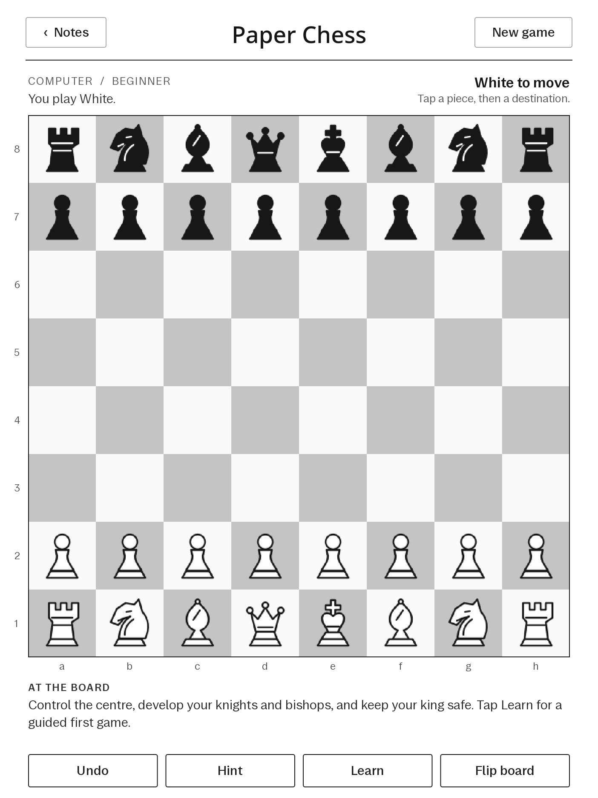
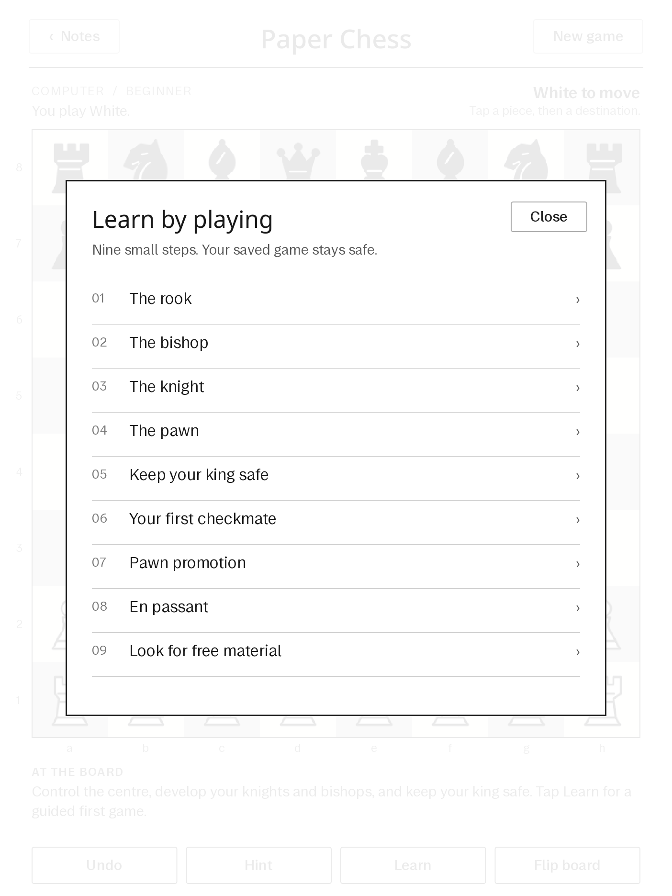

<div align="center">

# Paper Chess
### A chess board where your notebooks live.

Offline chess, pass-and-play and interactive lessons for **reMarkable 2**.

[](https://github.com/SILLEN69/paper-chess/actions/workflows/test.yml)
[](https://github.com/SILLEN69/paper-chess/releases)
[](LICENSE)

[Install](#install) · [How it works](docs/ENGINEERING.md) · [Build](docs/BUILD.md) · [Recovery](docs/INSTALL.md#disable-or-remove)



*Real render captured from the tablet. No mockup.*

</div>

## Built for the paper screen

I built a chess app for my reMarkable 2 because I wanted to play and learn on the same device I use for notes. The interesting part was making it feel at home on an e-ink screen, then making the switch back to notebooks reliable.

Paper Chess combines a Go game server, a QtQuick interface and a small native bridge. It runs entirely on the tablet. No account, cloud service or subscription is needed to play.

| Play | Learn | Pick up where you left off |
| :--- | :--- | :--- |
| Computer opponent with three difficulty settings, or local two-player | Nine interactive lessons, legal-move dots, hints and undo | Every move saved; open with a triple power press and return with **Notes** |

The opponent uses a small custom search engine. It is a practice partner, with no claimed Elo rating. Legal rules come from `notnil/chess`; castling, en passant and all four promotion choices are supported.

<details>
<summary><b>See the lesson screen</b></summary>
<br>


Rook · Bishop · Knight · Pawn · Castling · Checkmate · Promotion · En passant · Free material.

Lessons keep their own progress and leave your saved game intact.
</details>

## Install

**Experimental. Verified only on reMarkable 2, firmware `3.29.0.153`, Qt `6.10.3`.** The installer checks the exact firmware and original writing-app hash and refuses other builds. Do not downgrade or reset your tablet to meet these requirements. Back up your notebooks first.

SSH into your tablet as `root`, then paste this one command:

```sh
wget -q -T 60 -O /tmp/paper-chess-install.sh https://raw.githubusercontent.com/SILLEN69/paper-chess/v0.2.0/install-online.sh && sh /tmp/paper-chess-install.sh
```

It downloads the pinned release, verifies its SHA256, installs the files and enables the power-button listener. No compiling or manual extraction. Review [the script](install-online.sh) before running it if you prefer.

1. **Triple-press power within two seconds** to open chess.
2. Tap a piece, then a destination. **New game** chooses computer or local play; **Learn** opens the lessons.
3. Tap **Notes** to return to your notebooks. A repeated shortcut keeps chess open.

**Flip screen** turns the complete interface toward the other player: controls, headings, menus and pieces. The board keeps the other player's perspective, and a second press returns it. Choosing Black against the computer keeps the controls upright.

Allow roughly **20–30 seconds when reopening** while the native interface initializes. Wake the device first if it is asleep. Normal notebook sync pauses during chess and resumes in Notes.

[Full install, offline install and removal guide →](docs/INSTALL.md)

## The engineering behind it

The hardest bug was a rapid exit/reopen that could restart the tablet. A quiet CPU moment looked like startup had finished, but the native interface was still initializing. The firmware's inherited failure handling made a process crash much more disruptive.

The repaired launcher waits for the native library-loaded event and a minimum startup age, serializes transitions, and keeps recovery timers tied to one session. Chess runs in its own manually started service, leaving the stock writing service unchanged. The bridge drains queued Qt work before closing.

[Read the architecture, tradeoffs and debugging story →](docs/ENGINEERING.md)

## What was verified

- Game/save, lesson, engine and power-shortcut tests passed locally and on the ARMv7 tablet; all nine lesson positions were checked.
- Qt 6.10.3 QML lint passed. Device input tests covered computer replies, local moves, quick taps, hints, undo, lessons and returning to Notes.
- Three immediate Notes-action → power-shortcut reopen cycles passed after the launcher repair, with an unchanged OS boot ID and saved game. Extra shortcuts and stale recovery timers were also checked.
- Hash comparisons found no changes to 893 existing ink/PDF files during the original device installation and launcher verification.
- The public installer has isolated checks for unsupported firmware, corrupt downloads, reinstall/save preservation and rollback after a simulated service-start failure.
- The published `v0.1.2` one-command install was run on the physical tablet. All 21 runtime checksums matched afterward; the saved game, ink/PDF hashes, original writing binary and OS boot ID stayed unchanged.

These checks describe one device and one firmware build. They are not a claim of universal compatibility, crash-free operation or measured battery life. The native bridge relies on private Qt ABI and must be revalidated for future firmware.

## Build and contribute

The source includes the Go backend, QtQuick UI, native bridge, original SVG pieces, service controller and installer. [Build instructions](docs/BUILD.md) include the ARMv7 cross-compilation commands and local checks. [Releases](https://github.com/SILLEN69/paper-chess/releases) contain a prebuilt bundle and checksum.

Useful next steps are broader device testing, a firmware compatibility matrix, and more beginner exercises. Report your firmware and exact error with any issue; leave out passwords and notebook contents.

## Credits and license

Created by [SILLEN69](https://github.com/SILLEN69), with AI-assisted implementation and testing. The custom search, lesson flow, UI, SVG pieces and launcher integration are part of this project.

- [notnil/chess](https://github.com/notnil/chess), commit `1cbb4564a26ff96dbe4bb54449eeb0e18e8a49e8`: chess rules, vendored under [MIT](third_party/chess/LICENSE).
- [Inkling](https://github.com/nathanmarlor/inkling), commit `089efb2c9f24ce64127c6fc4d7fd30f93ae5ad94`: native Qt bridge adapted under [MIT](INKLING-LICENSE).
- [xovi-tripletap](https://github.com/rmitchellscott/xovi-tripletap): inspiration for the power shortcut and idle precaution; that package is not installed.

[MIT license](LICENSE). No reMarkable firmware or Qt libraries are redistributed. This is an independent project, unaffiliated with reMarkable.
