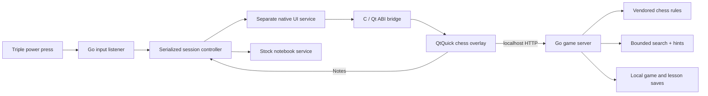

# A chess app inside an e-ink tablet

## The problem

A reMarkable 2 is a good place for a quiet chess board: a large monochrome screen, precise touch input and no need for a browser. The challenge was fitting a small game into an embedded device that already has its own native UI, power handling and recovery rules.

The scope was offline play, local two-player, useful beginner lessons and a convenient route back to notebooks. There is no online multiplayer, cloud backend or heavy external engine.

## Architecture

**Go** owns game state, move validation, a modest bounded search, lesson progression, saved games and power-event detection. The HTTP API binds to `127.0.0.1:9148`, not the Wi-Fi interface. There are no analytics or network calls during play.

**QtQuick** draws a touch-first monochrome board and controls with original SVG pieces. It avoids animation on e-ink, shows legal moves, and queues quick actions to preserve tap order. Lessons have separate state so experimenting does not overwrite a saved game.

Manual screen orientation is stored separately from board perspective. The Flip screen action turns the whole QML root and selects the opposite board perspective; touch coordinates follow Qt's transform. Existing saves and computer games played as Black keep an upright screen unless manually flipped.

**The C bridge** adapts Inkling's Qt ABI technique. It resolves symbols from the tablet's existing libraries, creates the QML overlay on the GUI thread, and disables input to the underlying native items during chess. It makes no function hooks or notebook-editing calls. It still depends on private native interfaces, so compatibility is deliberately narrow.

**The session controller** switches between the stock service and a separate chess UI service. It uses a lock, explicit readiness, session-owned recovery timers and a bridge shutdown acknowledgement. Only the power listener starts at boot.

## The reopen race

The first release could play chess, but immediately returning to Notes and reopening exposed a lifecycle bug. There were three contributing mechanisms:

1. A short CPU-idle gap occurred before the native interface had finished initializing. Stopping it during that window could trigger a segmentation fault.
2. Extra triple presses acted as a toggle during startup, creating another close/start transition.
3. The stock unit's inherited failure dependency remained after an attempted drop-in reset. A native crash could therefore invoke the firmware's reboot service.

The repair made the shortcut **open-only** and kept **Notes** as the exit action. A lock now covers the full transition. Readiness requires a library-loaded log from the **current systemd invocation** plus a minimum 15-second monotonic startup age. Recovery callbacks carry a session ID and ignore older sessions. The bridge acknowledges that queued Qt work has stopped before shutdown.

Most importantly, the chess interface now runs in a separate, manually started service with its own recovery path. The stock `xochitl.service` and executable are unchanged. This reduces coupling to the stock reboot handler; it does not make native integration risk-free.

## Tradeoffs

- **Slower reopen, clearer lifecycle:** the initialization wait makes rapid reopen take about 20–30 seconds on the tested device. There is no claim of instant launch.
- **Exact compatibility:** firmware `3.29.0.153` and the original binary hash are checked before installation and launch. A firmware update requires validation, not changing a version string.
- **Sync pauses during play:** the stock sync service follows the normal writing service. Returning to Notes resumes it.
- **Small opponent:** a local custom search keeps deployment self-contained. Difficulty labels are not Elo ratings or a claim of Stockfish strength.
- **Recoverable app setup:** programs live in `/home/root/paper-chess`, saves live separately, and services can be disabled. No firmware image, bootloader or notebook database is modified by the installer.

## Evidence and limits

The Go test groups passed on Windows and as compiled ARMv7 tests on the physical tablet. QML lint used Qt 6.10.3. Device input tests exercised both play modes, fast taps, undo, hint, lessons, promotion controls and the Notes action. The power detector was exercised through the kernel input stream; these were automated events, not claimed human button presses.

After the repair, three immediate Notes-action → power-shortcut cycles kept the same OS boot ID and saved moves. Additional presses during startup and while open, stale timers and the service watchdog interval were checked. The Notes action in the repeated final regression was invoked through its actual local endpoint. Earlier device testing also exercised the touchscreen exit control.

Hash comparisons of 893 existing ink/PDF files stayed unchanged through installation and the launcher repair. That is evidence from this tablet, not a guarantee about every device. No battery benchmark or multi-firmware validation has been performed.

## Portfolio description

> Built an offline chess app for reMarkable 2 with a custom e-ink interface, a Go computer opponent, local two-player mode and nine interactive lessons. Integrated native Qt rendering and a power-button launcher, then debugged a firmware lifecycle race using serialized transitions, explicit readiness and session-scoped recovery. Packaged it with a checksum-verified installer and documented rollback.

Built with AI assistance. Existing MIT chess rules and the Inkling bridge are credited in the project README; the tablet firmware and Qt runtime are not redistributed.
